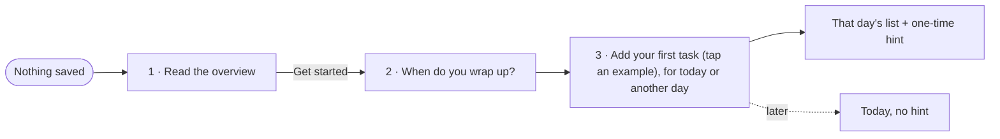
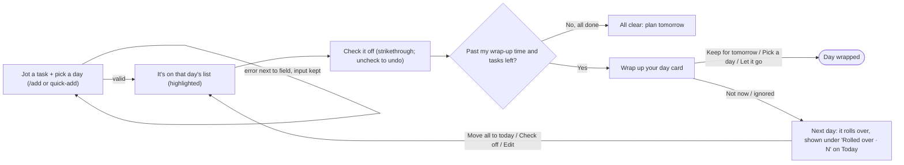

# Dayplan

A personal to-do list where every task belongs to a day. You add tasks to today or any day ahead and check them off. At a wrap-up time you choose, Dayplan asks what to do with anything left. Whatever you skip rolls over to the next day, so nothing uncomplete gets lost.

It's built with Next.js and Tailwind CSS, and everything is saved in the browser with localStorage, with no accounts or database.

## Flows

### First visit

> **I open Dayplan with nothing saved → I read what it's for → I set when I'm usually done for the day → I add my first task by tapping an example, for today or another day → I land on Today (or At a Glance, for a later day), with a one-time hint on how it works.**

### Main task

> **I jot a task for a certain day → it's on that day's list → I check it off → at my wrap-up time, I keep or push what's left; if I don't, it rolls over to tomorrow.**

## First-run check (Step 8)

I had my agent send three testers to the live site. Each used a fresh browser with nothing saved, and they acted as brand-new users. One went through the **first visit**, one did the **main task** (adding, editing, reordering), and one **came back later**, using a faked clock to cover wrap-up time, the next day, and weeks away. They tried many inputs and combinations and reported what they found without changing any code.

### Usability feedback

- **The "too similar" warning is too eager.** Numbered tasks like "Task number 1" then "Task number 2", "Read ch 3" then "Read ch 4", or "Buy milk" then "Buy silk" all need Add pressed twice.
- **Only `/` sends a brand-new user to onboarding.** Opening At a Glance, Calendar, Done, or Add first skips it.
- **The footer still says "Saved on this device" when saving fails,** even while the warning banner is showing.
- **Esc during a drag doesn't cancel it.** The move still happens.
- **Onboarding forgets the wrap-up time you picked** if you go Back to the overview and forward again.
- **The browser's Back button leaves onboarding** instead of going to the previous step.
- **Tapping an example task in onboarding replaces what you typed,** with no undo.
- **A past date in an Add link (`/add?date=2020-01-01`) quietly becomes Today,** with no message.

### Bugs it found

- **Undo can erase newer changes.** If you delete a task, add another, and then press Undo on the delete, the new task is lost too. The same happens across two open tabs.
- **Partly broken saved data crashes the page.** Instead of the "We couldn't read your saved tasks" recovery, the page shows "This page couldn't load".
- **Onboarding can be run again after it's done** by opening `/welcome`. Doing so quietly changes the wrap-up time.
- **The "too early" check for the wrap-up time can be skipped** by switching away from Other time and back.

### Smaller polish notes

- **Labels and notes:**
  - Tasks rolled over for a week or more say "30 days" instead of "from Sep 20".
  - A rolled-over task loses its original day once you check it off.
  - The far-future warning says "press the button again" instead of naming the button.
  - A nonsense year like 275760 gets "Pick a day" instead of a "not a real date" message.
- **Screen readers:**
  - Onboarding's step 2 heading is read twice.
  - The wrap-up card reads its text without spaces ("onefrom Sun").
  - A move can be announced as "Added".
