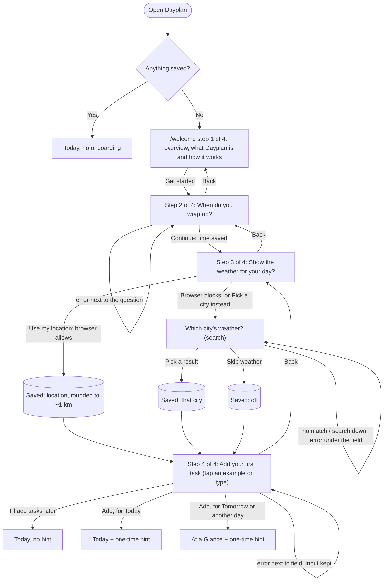
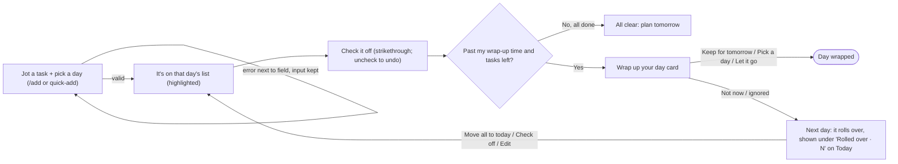
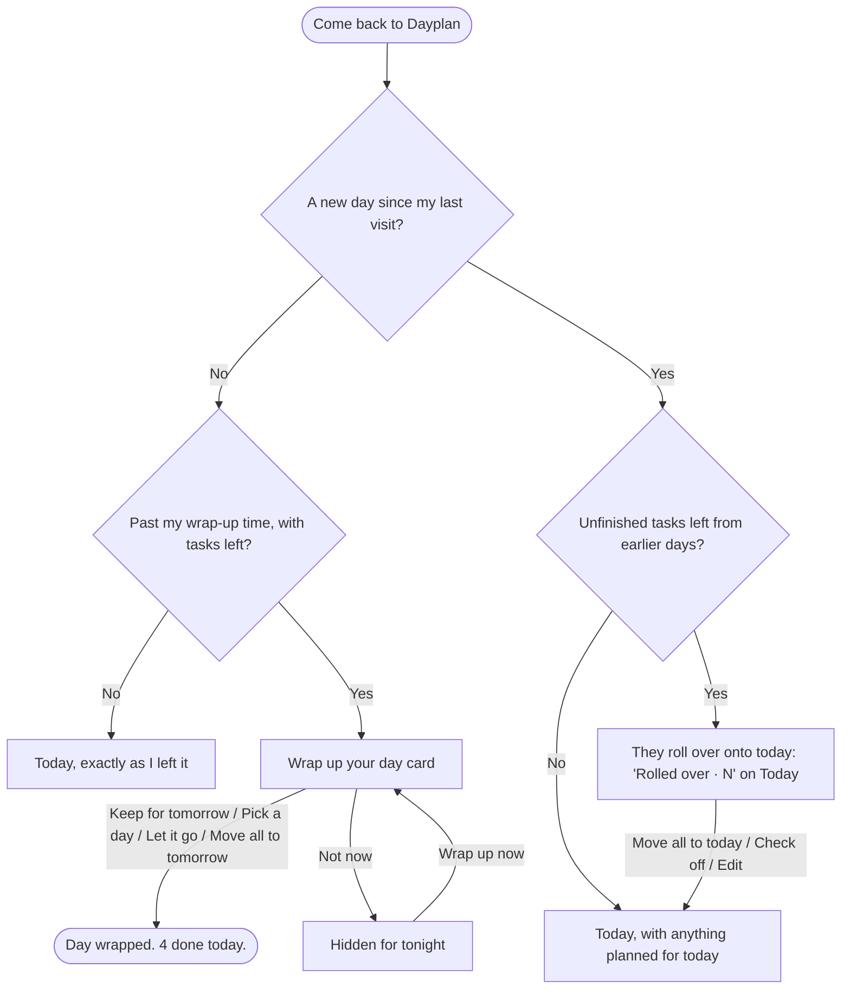

# Flows

Dayplan's three flows: the first visit, the main task, and coming back.

## First visit

> **I open Dayplan with nothing saved → I read what it's for → I set when I'm usually done for the day → I choose where my weather comes from → I add my first task by tapping an example, for today or another day → I land on Today (or At a Glance, for a later day), with a one-time hint on how it works.**

## Main task

> **I jot a task for a certain day → it's on that day's list → I check it off → at my wrap-up time, I keep or push what's left; if I don't, it rolls over to tomorrow.**

**Steps**
1. **Jot a task for a day:** on `/add` (Task + Day: Today, Tomorrow, or Pick a day), or quick-add on Today.
2. **It's on that day's list:** you land on Today, or At a Glance for a later day, with the new task highlighted.
3. **Check it off:** it's struck through. Uncheck to undo.
4. **Wrap up:** at your wrap-up time, a card offers Keep for tomorrow, Pick a day, or Let it go for each task left.
5. **Otherwise, roll over:** unfinished tasks move to the next day, under **Rolled over** on Today.

**States**
- Loading (a skeleton, never a flash of "empty")
- Empty day, with a button to add a task
- Just added (highlighted)
- All done for the day
- Wrap-up due, dismissed, or wrapped
- Rolled over tasks waiting

**Errors** (shown next to the field, saying what to do next, keeping what you typed)
- "Enter a task name."
- "Shorten this to 120 characters or fewer."
- "Pick a day for this task." / "Pick today or a later day." / "That's not a real date. Check the year."
- A task already on that day, or very similar to one: a soft warning. Press Add again to keep both.
- A date more than a year away: a soft warning to check the year.
- The browser can't save, storage is full, or saved data can't be read: a banner says so.

## Coming back

> **I come back in the evening → at my wrap-up time Dayplan asks what to do with what's left → I keep it for tomorrow, move it, or let it go → if I skip that, tomorrow it has rolled over to the next day.**

## Weather

> **I open Today → I see the weather where I am (or my chosen city) → the week ahead sits next to each day on At a Glance → it stays current while I use the app, without asking the API more than it needs to.**

Where it comes from is chosen once, in onboarding (or on Today, for anyone who signed up before weather existed), and saved in Supabase (`user_settings`):
- **Location:** this device's position when the browser allows it; otherwise the last saved coordinates.
- **City:** the searched city, always.
- **Off:** no weather anywhere.

**When it's fetched** (from the browser; Open-Meteo needs no key, and each person's requests count against their own limit):
- When the app opens.
- On a page switch, on returning to the tab, and on a check every 5 minutes, but only if the forecast is 30+ minutes old.
- Never while the tab is in the background. After a failed call, not again for 5 minutes.

**States**
- Loading: a placeholder the size of the card.
- Not chosen yet, or "location" with no position shared and none saved: the card asks (location → city → off).
- Off: nothing shown.
- API down: "Weather is unavailable right now. Your tasks are fine." If an earlier forecast exists, it stays, with "Couldn't refresh."
- City search: "No places match…" when nothing is found; "City search isn't working right now…" when the API is down.
- Settings can't load (Supabase unreachable): a short message; onboarding lets you continue without weather.

